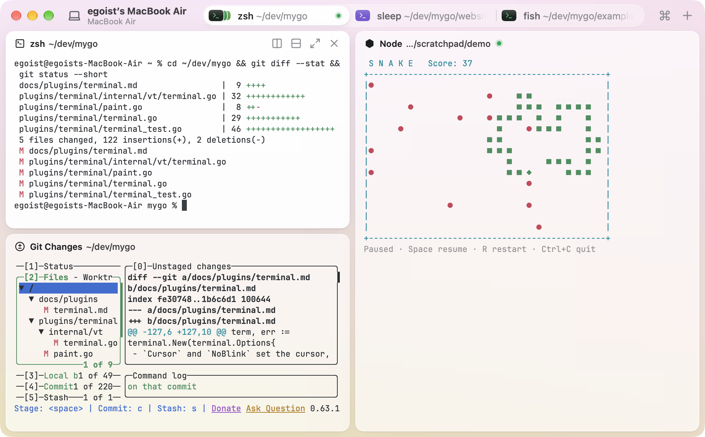
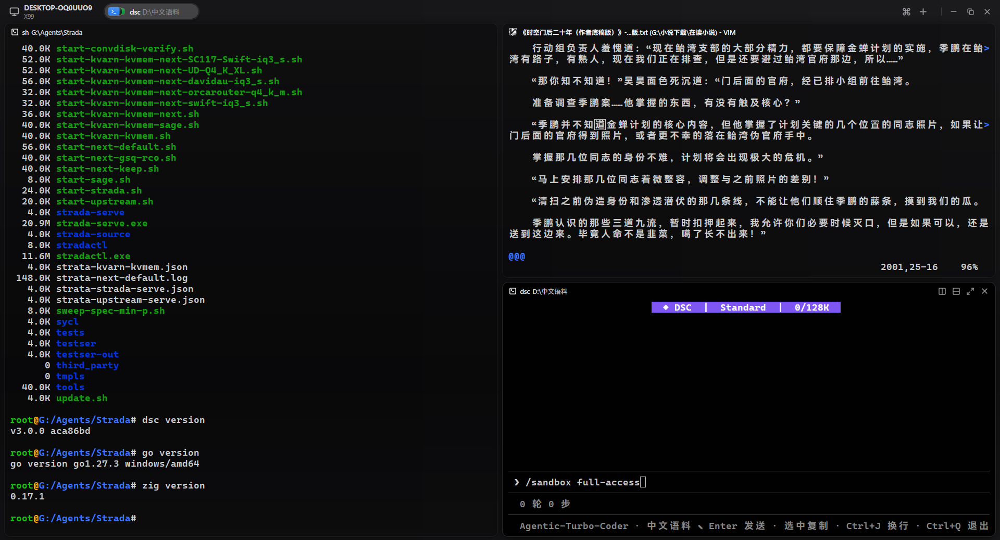

# torex

用 Go 实现、基于 [MyGo](https://mygo.egoist.dev) 原生 UI 及其终端插件（Ghostty 的 libghostty-vt）的 [Superlogical Rex](https://www.superlogical.com/updates/public-testing-beginning) 终端复刻。无 webview、无 cgo：一个应用（Windows 版因内嵌运行时约 54 MB）。





## 功能

- **标签页与分屏窗格。** 独占一个标签页的窗格是一张浮在窗口渐变之上的卡片，终端铺满其中；指针移到顶部时，它的头部（程序图标、名称、目录，以及分屏、缩放、关闭按钮）浮现在终端上方。分屏后每个窗格都有自己的头部。拖动窗格之间的间隙可调整大小（双击把分屏重置为对半）。
- **持久会话。** shell 跑在会话服务器里——同一个二进制的后台进程（`torex -server`）。退出 torex 后一切照常运行；再打开时，每个标签页、分屏、窗格都按原样回来，程序仍在运行。服务器把每个会话的画面保存在无头的 libghostty-vt 模拟器中，附加时发送快照，因此全屏程序（lazygit、vim、htop……）能原封不动地恢复。
- **程序活动。** 服务器观察每个终端的前台进程（`tcgetpgrp`、`sysctl`、`proc_pidinfo`；Windows 上则是 shell 最新的子进程及其命令行与目录）：头部和标签页显示程序名（`Node`、lazygit 显示为 `Git Changes`、`Codex`、`SSH host`……）及其工作目录；绿点表示程序正在输出，橙点表示窗格里的程序已结束或在不被注意时响铃。窗口在后台时，长命令结束会发通知。
- **标签页图标**把该标签页各程序的色块叠起来（聚焦窗格的在最前），与 Rex 一致。标签页可拖动排序、双击重命名，并有右键菜单。
- **主机信息条**显示机器名与型号；点开的浮层里有芯片、内存、操作系统与会话服务器。
- **命令面板**（⇧⌘P、Ctrl+Shift+P 或 ⌘ 按钮）：所有命令与所有窗格，模糊匹配。
- 浅色与深色外观（查看 ▸ 外观）、字号（⌘+ ⌘− ⌘0），内嵌 JetBrains Mono。

## 快捷键

| macOS | Windows、Linux | |
|---|---|---|
| ⌘T | Ctrl+Shift+T | 新建标签页 |
| ⌘D / ⇧⌘D | Ctrl+Shift+D / Ctrl+Shift+E | 向右 / 向下分屏 |
| ⌘W / ⇧⌘W | Ctrl+Shift+W | 关闭窗格 / 标签页 |
| ⇧⌘↩ | Ctrl+Shift+Enter | 缩放窗格 |
| ⌥⌘ 方向键 | Alt+方向键 | 聚焦该方向的窗格 |
| ⌃⌘ 方向键 | Alt+Shift+方向键 | 移动最近的分隔线 |
| ⌃⌘= | | 均分窗格 |
| ⌘1…⌘9、⇧⌘[ ⇧⌘]、⌃Tab | Ctrl+Shift+1…9、Ctrl+PageUp/PageDown、Ctrl+Tab | 切换标签页 |
| ⇧⌘R | Ctrl+Shift+R | 重命名标签页 |
| ⇧⌘P、⌘P | Ctrl+Shift+P | 命令面板 |
| ⌘K | Ctrl+Shift+K | 清屏 |
| ⌘+ ⌘− ⌘0 | Ctrl+= Ctrl+- Ctrl+0 | 字号 |
| ⌥⌘Q | | 退出并结束所有会话 |

在 macOS 之外的平台，Control+字母属于终端（Ctrl+C、Ctrl+D、Ctrl+W……），所以 torex 的快捷键都带 Shift，复制粘贴亦然（Ctrl+Shift+C、Ctrl+Shift+V）；也没有任何快捷键占用 Control+Alt，因为在很多键盘上那是用来打字符的（AltGr）。

## 开发与构建

torex 需要 [Go](https://go.dev/dl/) 1.27+ 与 MyGo 0.3.0，其 CLI 由 `go.mod` 以 tool 形式固定：

```sh
go tool mygo dev     # torex Dev，随代码改动重建并重启
go test ./...        # 会话服务器，以及无窗口的视图
go tool mygo build   # build/darwin-arm64/torex.app 与 .dmg
go run ./tools/mkapp # 同上，并把 Windows 安装包命名为「Torex Setup …」
go run ./tools/mkbusybox       # 用 zig 从源码构建 WinKit 的 shell
go run ./tools/mkbusybox -app  # Windows：先 shell，再 torex
go run ./tools/mkvim           # 用 zig 从源码构建 vim
go run ./tools/mkvim -app      # Windows：先 vim，再 torex
go run ./tools/mkssh           # 构建运行时的 ssh 客户端
go run ./tools/mkssh -app      # Windows：先 ssh，再 torex
go run ./tools/mkicon  # 重绘 resources/icon.png
```

`go get -tool github.com/egoist/mygo/cmd/mygo@latest` 会一并更新 MyGo 与其 CLI。

应用把状态保存在自己的数据目录：服务器的套接字与日志、`layout.json` 和 `settings.json`；正式版在 `~/Library/Application Support/torex`，`mygo dev` 的在 `torex Dev`，所以开发永远不会碰到你在用的那份应用的会话（`TOREX_DIR` 可指定别的目录）。会话比应用活得久，但撑不过一次重建：开发版会替换旧版启动的服务器，结束其会话，随后这些会话在原目录重新启动。

### Windows

torex 运行于 Windows 10 1809 或更高版本，由 ConPTY 承载 shell；数据目录是 `%AppData%\torex`。程序是 `torex.exe`，安装包是 `Torex Setup 0.1.0.exe`——`tools/mkapp` 在 `go tool mygo build` 之后把它的名字改写成产品名。窗格跑的是 WinKit 的 POSIX shell——把它的 `busybox` 当作 `sh`，从源码构建并内嵌进 torex，运行时解包到数据目录下——不使用 Windows 的任何 shell：没有 PowerShell，没有 `cmd`，这样无论机器上装了什么，每个窗格的行为都一致。登录 shell 会设置 WinKit 的环境与提示符：窗口提权时是 `root@…`，否则是 Windows 用户名。`~` 指向 Windows 用户真正的家目录 `C:\Users\<用户名>`，因此 `~/.ssh` 的密钥、`~/.vimrc` 以及各程序的缓存都在它们自己的位置；提示符里的 `root` 只表示提权，不改变路径。窗口无边框，标题栏用这些按钮画出最小化、最大化与关闭；只能从两侧和底部调整大小，不能从顶部。

`internal/winkit` 承载内嵌进应用的运行时：WinKit 的 `busybox.exe`（作为 `sh`），连同 `winkit.ini` 与登录 shell 会读的 profile。`third_party/winkit` 有 WinKit 的源码（MIT）与 busybox-w32 源码包，`tools/mkbusybox` 会校验其校验和；该工具像 WinKit 的 Dockerfile 那样打上补丁并用 zig 构建 shell。`go run ./tools/mkbusybox -app` 用 Go 先构建 shell、再构建 torex；`go build` 与 `go tool mygo build` 内嵌 `internal/winkit/runtime` 里的 shell，新的一份按校验和解包到数据目录下。构建 shell 需要 zig、`make` 和 Git（Git 的 POSIX shell 用来跑 make 的配方，`git apply` 用来打补丁）；`tools/mkbusybox` 也会到 `%WINKIT_HOME%` 里找 WinKit 的 zig 与 make。

运行时还带有作为编辑器的 vim：控制台版 `vim.exe` 及其运行时文件，一并内嵌并在 shell 旁边解包。`$VIMRUNTIME` 指向这些文件，其中的 `vimrc`——Windows 上的 vim 没有别的系统 vimrc 入口——为 vim 提供默认设置和运行时的 POSIX shell，于是过滤器或 `:!` 走的是 `sh` 而不是 `cmd`。`third_party/vim` 有源码包与这个 `vimrc`；`tools/mkvim` 校验校验和，用 zig 与 windres（来自 `%WINKIT_HOME%`）构建 `vim.exe`，再把编辑器和它的运行时复制进 `internal/winkit/runtime`。`vi` 是 `vim` 的别名。

shell 没有 ssh，所以运行时自带一个：用 Go 写的客户端（`cmd/ssh`，由 `tools/mkssh` 构建为 `bin/ssh.exe`），用 `~/.ssh` 里的密钥或密码登录，按 `~/.ssh/known_hosts` 校验主机，并在与窗格同尺寸的终端里运行 shell。它不读 `~/.ssh/config`，不使用 agent，也没有端口转发。

torex 所在的安装目录也参与运行时，`$TOREX_HOME` 指向它：`bin` 排在 `PATH` 最前，放用户自己的程序；`etc/profile` 在内置 profile 之后加载，适合配置环境变量；`share` 不自动搜索，独立程序包放那里，由 `$TOREX_HOME/etc/profile` 自行指向。这样不必改仓库或重编，也能给每个窗格加上自己的工具与环境。首次启动会在 `bin` 与 `etc` 各留一份带注释的说明（`README.txt` 与 `profile`），之后不再覆盖，随你修改。

Windows 上 torex 每次启动都会把「在此目录启动 torex」写进资源管理器的右键菜单（`HKCU\Software\Classes\Directory` 与 `Directory\Background` 下的 `torex` 键），这样在任意文件夹或其空白处都能启动，并在该目录开一个标签页。窗口只运行一个：再次启动时，新进程把目录交给已在运行的窗口（`%TOREX_DIR%\open` 下的请求）后退出。`torex -uninstall` 移除该菜单项；卸载程序不会动它，卸载后需要手动运行一次。

## 代码结构

| | |
|---|---|
| `main.go` | 应用、它的窗口，以及 `-server` |
| `state.go` | 标签页、分屏树、窗格，布局的保存与恢复 |
| `view.go`、`tabs.go`、`host.go`、`commands.go` | 界面：标题栏、标签页、窗格、主机浮层、菜单与命令面板 |
| `programs.go` | 程序的呈现方式：名称、图标、色块颜色 |
| `style.go`、`settings.go` | 颜色、字体、终端主题；外观与字号 |
| `internal/rex` | 会话服务器及其客户端：PTY、前台进程、无头画面、套接字协议 |
| `internal/winkit` | 内嵌进应用的 WinKit 运行时，及其解包；源码在 `third_party/winkit` |
| `cmd/ssh`、`tools/mkssh` | 该运行时的 ssh 客户端，以及把它构建进去 |
| `tools/mkbusybox`、`tools/mkvim`、`tools/zigcc` | 用 zig 从 WinKit 的 busybox-w32 与 vim 源码构建该运行时 |
| `tools/mkapp` | 用 MyGo 构建应用，并把 Windows 安装包命名为「Torex Setup …」 |

未复刻：Rex 连接其他机器上服务器的能力；torex 的服务器只监听本地套接字。

图标：[Lucide](https://lucide.dev)（ISC）与 [Simple Icons](https://simpleicons.org)（CC0）。字体：[JetBrains Mono](https://www.jetbrains.com/lp/mono/)（OFL）。
